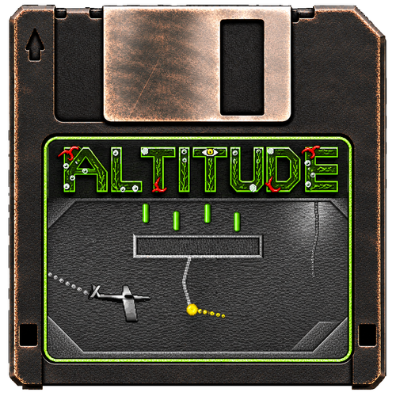

# Altitude for the Datafrog SF3500



*Altitude* is a free game by Daniel "Imerion" Eriksson (NeoTron Games): a space miner flies through
tunnels full of hazards, collecting crystals while gravity keeps pulling the ship down. Seven levels,
power-ups, and a high score. The studio's games have mostly disappeared from the web; this port is a
small tribute and keeps the game playable on a handheld.

This repository is the source of the port for the Datafrog SF3500 (MIPS32r2, no GPU). The game's files
are the author's, unchanged, and are included in `game/` because his licence allows free
redistribution of the unmodified game.

The player's guide (controls, launcher, options, high scores, pause, the computer opponent) is in
[package-src/README.md](package-src/README.md), which is also the README inside the installed folder.

## What the port adds

None of this alters the game's files.

* **A runtime** for the SF3500's CPU. The game was written for the old Fenix engine; it is run with
  BennuGD (Fenix's descendant), changed to draw to the SF3500's display, play through its audio path,
  read its pad, play tracker music, and run the game's 8-bit mode.
* **A launcher** that comes first: Play Game, Options, How to Play, Exit.
* **A computer opponent** that can fly Player 2 in the two-player modes, since the handheld has one set
  of controls.
* **A pause**: Start stops a level in flight, and Start again carries on. The game has no pause.

## Install

Build it (below), or take a release if one is published. Copy the contents of `package/` to the
card's `roms/ports/`, so that you have `roms/ports/Altitude.sh` and `roms/ports/neotron-altitude/`.

## Building

You need: the SF3500 MIPS toolchain (a Codescape MIPS MTI GCC 6.3 sysroot with libpng and zlib), cmake,
make, python3 with Pillow, the DejaVu fonts, and qemu-user for mipsel (the compiler is built for the
handheld's CPU and run under qemu).

Put three upstream tarballs in `deps/` (their checksums are verified):

| File | From |
|---|---|
| `SDL2-2.0.14.tar.gz` | https://github.com/libsdl-org/SDL/releases/download/release-2.0.14/SDL2-2.0.14.tar.gz |
| `SDL2_mixer-2.6.3.tar.gz` | https://github.com/libsdl-org/SDL_mixer/releases/download/release-2.6.3/SDL2_mixer-2.6.3.tar.gz |
| `libxmp-lite-4.6.0.tar.gz` | https://github.com/libxmp/libxmp/releases/download/libxmp-4.6.0/libxmp-lite-4.6.0.tar.gz |

Then:

```sh
SF3500_TC=/path/to/toolchain/host ./build_sf3500.sh     # runtime, compiler, game and launcher bytecode
./package.sh                                            # assembles package/
```

The build is reproducible: the runtime and the bytecode come out byte for byte the same wherever the
repository is checked out (the compiler is given relative source paths, and the date stored in the bytecode
is fixed by `SOURCE_DATE_EPOCH`, default 1700000000).

`build_sf3500.sh` explains its other settings (`QEMU`, `PY`, `FONT_DIR`, `OUT`) in its header. The
SDL2 and SDL2_mixer sources are patched on the fly (`runtime/sf3500/*.patch`); nothing of theirs is
copied into this repository.

## Layout

| Folder | Contents |
|---|---|
| `runtime/` | the modified BennuGD source (zlib licence), the SDL2 and SDL2_mixer patches, and the SF3500 display, audio and input layer in `runtime/src/sf3500/` |
| `runtime/modules/mod_grproc/sf3500_bot.inc` | the computer opponent |
| `runtime/modules/mod_grproc/sf3500_pause.inc`, `sf3500_score.inc` | the test for "a ship is flying" (pause), and the tracker of the player's best score; the pause loop itself is in `runtime/modules/libsdlhandler/libsdlhandler.c` |
| `launcher/` | the launcher script, the font generator, and the check that every text line fits its panel |
| `tools/` | the script that prepares the game for BennuGD, the compiler build, and test scripts that run the game headless |
| `game/` | the author's original files, byte for byte |
| `package-src/` | the start script, box art, and the player's README |
| `licenses/` | licence texts of everything bundled |

Developer notes (design, the runtime's changes, test results, device findings) are in
[DEV-NOTES.md](DEV-NOTES.md).

## About `altitude.dcb`

The author's compiled game is for Fenix, which does not run on this device. `build_sf3500.sh` compiles
his `altitude.prg` with BennuGD's compiler instead. BennuGD wants `import` lines after the first line
of a script, which Fenix did not, so `tools/make-bennu-prg.sh` makes a compile copy with those lines
inserted. His script is never edited; `game/altitude.prg` is byte-identical to the one he published.

## Licences

* **Altitude** (everything in `game/`): copyright Daniel "Imerion" Eriksson. Free to share, content
  unchanged, not for sale (`game/Readme.txt`).
* **The runtime** is BennuGD (zlib licence, SplinterGU and the Fenix team), by way of the Vita SoRR
  port by Sarcastic Cat, and is changed here, so it is a modified version, not the original. SDL2,
  SDL2_mixer and zlib are zlib-licensed, libpng has its own licence, libxmp-lite is MIT, and the
  launcher's text uses glyphs from the DejaVu fonts. The SF3500 display, audio and gamepad layer is
  derived from TreeFrogUI's pico286 SF3000 patch and picoarch's SF3000 code. Texts are in `licenses/`;
  who wrote what is in `licenses/CREDITS.txt`.
* **What was written for this port** (the launcher, the computer opponent, the pause, the score tracker, the scripts and packaging)
  is released under the Unlicense, see [LICENSE](LICENSE).
